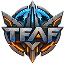

  

<h1 align="center">TFAF</h1>

  Неофициальный клиент <a href="https://www.faforever.com">Forged Alliance Forever</a> для Supreme Commander: Forged Alliance

  
  
  

  <a href="https://github.com/tergride/tfaf-releases/releases/latest"><b>Скачать последнюю версию</b></a>
  &nbsp;·&nbsp;
  <a href="https://github.com/tergride/tfaf-releases/releases">Все версии</a>
  &nbsp;·&nbsp;
  <a href="#english">English</a>

---

TFAF — неофициальный клиент Forged Alliance Forever, альтернатива официальному клиенту FAF. Он работает с вашим аккаунтом FAF и подключается к тем же серверам, поэтому вы играете вместе со всеми игроками FAF, в каком бы клиенте они ни сидели.

## Возможности

- Произвольные игры, кооператив и матчмейкер с группами.
- Чат FAF с личными сообщениями, списком друзей и каналом клана.
- Хранилище карт и модов: поиск, установка, отзывы и загрузка своих. Генератор карт Neroxis.
- Реплеи из хранилища FAF и из файлов, просмотр идущих игр.
- Перед игрой лаунчер сверяет файлы игры, карту и моды с хранилищем FAF и с хостом, а вкладка «Текущая игра» показывает связь и файлы каждого игрока.
- Игроки TFAF видят друг друга по значку у ника, а их лаунчеры договариваются о функциях лобби, например об изоляции модов.
- Свой сетевой адаптер без Java, совместимый с официальным клиентом.
- Профили игроков, рейтинги, турниры, новости, статус в Discord.
- Интерфейс на русском и английском.

## Установка

Нужны Windows 10 или 11 (64 бита), установленная Supreme Commander: Forged Alliance (Steam или GOG) и аккаунт на [faforever.com](https://www.faforever.com).

1. Скачайте `TFAF-Setup-<версия>.exe` из [последнего релиза](https://github.com/tergride/tfaf-releases/releases/latest) и запустите его.
2. Установщик не подписан, поэтому Windows SmartScreen предупредит о неизвестном издателе. Нажмите «Подробнее», затем «Выполнить в любом случае».
3. Лаунчер ставится без прав администратора в `%LOCALAPPDATA%\Programs\TFAF` и создаёт ярлык на рабочем столе.
4. Войдите в аккаунт FAF: вход проходит на странице FAF в браузере.

TFAF можно держать рядом с официальным клиентом. Карты, моды и настройки игры у них общие, а файлы FAF TFAF хранит в своей папке `C:\ProgramData\TFAF`.

## Обновления

Лаунчер проверяет обновления при запуске и раз в 4 часа, скачивает новую версию сам и ставит её при перезапуске. Во время игры обновление не ставится. Проверить обновления вручную и прочитать, что изменилось, можно в разделе «О программе». Описание всех версий есть и на странице [Releases](https://github.com/tergride/tfaf-releases/releases).

Сами обновляются версии начиная с 0.7.0. Версии до неё выходили раньше этого репозитория, их установщики лежат в релизах для истории. Если у вас одна из них, один раз поставьте последнюю версию поверх: настройки и вход сохранятся.

## Если что-то не работает

Логи помогают понять, что случилось. Приложите их, когда сообщаете о проблеме:

| Что | Где |
|---|---|
| Лог лаунчера | `%APPDATA%\tfaf-launcher\logs\launcher.log` |
| Логи игр | `C:\ProgramData\TFAF\logs` |

Обе папки открываются из меню под ником: «Открыть папку».

## Удаление

Удалите TFAF в «Параметры» → «Приложения». Настройки в `%APPDATA%\tfaf-launcher` и файлы FAF в `C:\ProgramData\TFAF` остаются, их можно удалить вручную.

## Что в этом репозитории

Только сборки и описания версий, исходного кода здесь нет. В каждом релизе:

| Файл | Зачем |
|---|---|
| `TFAF-Setup-<версия>.exe` | Установщик. |
| `TFAF-Setup-<версия>.exe.blockmap` | Карта блоков: при обновлении лаунчер скачивает только изменившиеся части. |
| `latest.yml` | Описание версии для автообновления. |

Релизы до 0.7.0 содержат только установщик.

## Правила и права

На серверах FAF действуют [правила FAF](https://www.faforever.com/rules). TFAF не правит файлы установленной игры и не даёт преимуществ в игре.

TFAF не связан с командой Forged Alliance Forever. Supreme Commander: Forged Alliance принадлежит её правообладателям.

---

## English

TFAF is an unofficial client for [Forged Alliance Forever](https://www.faforever.com), an alternative to the official FAF client for Supreme Commander: Forged Alliance. It signs in with your FAF account and connects to the same servers, so you play together with everyone on FAF, whichever client they use.

**Install.** You need Windows 10 or 11 (64-bit), Supreme Commander: Forged Alliance (Steam or GOG) and a FAF account. Download `TFAF-Setup-<version>.exe` from the [latest release](https://github.com/tergride/tfaf-releases/releases/latest) and run it. The installer is not signed, so Windows SmartScreen warns about an unknown publisher: click "More info", then "Run anyway". TFAF installs without administrator rights into `%LOCALAPPDATA%\Programs\TFAF` and can live next to the official client.

**Updates.** From version 0.7.0 on, the launcher checks for updates at startup and every 4 hours, downloads them by itself and installs them on restart, never during a game. The About page checks manually and shows the notes of every version. Older versions are kept here for the record and do not update themselves: install the latest one over them once.

**Problems.** Attach the launcher log `%APPDATA%\tfaf-launcher\logs\launcher.log` and the game logs from `C:\ProgramData\TFAF\logs` when reporting a problem. Both folders open from the menu under your name.

The [FAF rules](https://www.faforever.com/rules) apply on the FAF servers. TFAF does not modify the installed game and gives no in-game advantage. TFAF is not affiliated with the Forged Alliance Forever team.
